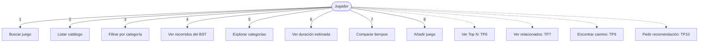

# Casos de uso — Juegoteca

El único actor es el **jugador**: la persona que usa la terminal para decidir a qué jugar. No hay
administradores ni perfiles de usuario.

## Diagrama general

Las líneas punteadas son casos de uso planificados que todavía no existen.

## CU1 — Buscar juego

- **Actor**: jugador.
- **Precondición**: el catálogo está cargado.
- **Flujo principal**:
  1. El jugador elige la opción 1.
  2. El sistema pide el nombre.
  3. El jugador lo escribe.
  4. El sistema lo busca sin distinguir mayúsculas y muestra el juego con su categoría.
- **Flujo alternativo**: si no existe, el sistema informa que no encontró ningún juego con ese nombre.
- **Postcondición**: el jugador vio el juego buscado, o supo que no está.

## CU2 — Listar catálogo

- **Actor**: jugador.
- **Precondición**: el catálogo está cargado.
- **Flujo principal**: el sistema muestra los juegos de a 20 por página, con su número. El jugador pasa de
  página con Enter y vuelve al menú con `q`.
- **Postcondición**: el jugador exploró el catálogo completo o parte de él.

## CU3 — Filtrar por categoría

- **Actor**: jugador.
- **Precondición**: el catálogo está cargado.
- **Flujo principal**: el jugador escribe una categoría (por ejemplo "Action") y el sistema lista los
  juegos que la tienen entre sus géneros.
- **Flujo alternativo**: si ningún juego tiene esa categoría, el sistema lo informa.
- **Postcondición**: el jugador vio los juegos de esa categoría.

## CU4 — Ver recorridos del BST

- **Actor**: jugador.
- **Precondición**: el catálogo está cargado.
- **Flujo principal**: el sistema muestra los primeros juegos según el recorrido inorder (alfabético),
  preorder y postorder del árbol binario de búsqueda.
- **Postcondición**: el jugador vio cómo cambia el orden según el recorrido.

## CU5 — Explorar categorías

- **Actor**: jugador.
- **Precondición**: el árbol de categorías está construido.
- **Flujo principal**:
  1. El jugador elige la opción 5 y una de tres vistas: navegar, ver el árbol completo o ver por niveles.
  2. En "navegar", elige un grupo (por ejemplo "Juegos") y luego un género.
  3. El sistema muestra los juegos de ese género.
- **Postcondición**: el jugador conoce cómo se agrupan los géneros y cuántos juegos tiene cada uno.

## CU6 — Ver duración estimada

- **Actor**: jugador.
- **Precondición**: el catálogo está cargado.
- **Flujo principal**: el jugador escribe un nombre y el sistema muestra el tiempo de juego promedio, en
  horas y minutos.
- **Flujo alternativo**: si el juego no existe, lo informa. Si existe pero no tiene dato de tiempo,
  avisa que no hay datos de duración.
- **Postcondición**: el jugador sabe cuánto suele jugarse ese título.

## CU7 — Comparar tiempos

- **Actor**: jugador.
- **Precondición**: el catálogo está cargado.
- **Flujo principal**:
  1. El jugador ingresa nombres de juegos, uno por línea. Una línea vacía termina la lista.
  2. El sistema busca cada uno.
  3. Muestra los juegos ordenados de menor a mayor tiempo, con la diferencia respecto del más corto.
- **Flujo alternativo**: los juegos que no existen o no tienen tiempo se informan aparte. Si quedan menos
  de dos juegos comparables, el sistema no compara.
- **Postcondición**: el jugador sabe cuál de los juegos le insumiría más tiempo.

## CU8 — Añadir juego

- **Actor**: jugador.
- **Precondición**: el catálogo está cargado.
- **Flujo principal**:
  1. El jugador ingresa nombre, géneros (separados por coma) y, si la sabe, la duración en horas.
  2. El sistema valida los datos.
  3. El sistema agrega el juego al catálogo, al BST y al AVL.
- **Flujo alternativo**: si el nombre está vacío o repetido, o algún género no existe, el sistema explica
  el error y no agrega nada. Con Enter vacío en el nombre o en los géneros se cancela.
- **Postcondición**: el juego se puede buscar de inmediato. Se pierde al cerrar el programa.
