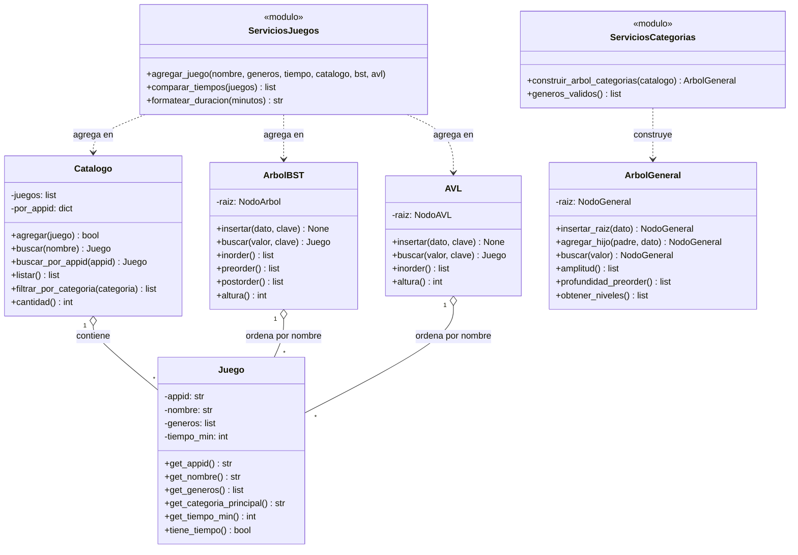

# Diagrama de clases

> Estado: TP5 más las funcionalidades de añadir, comparar y duración. Se actualiza en cada TP con la
> estructura nueva.

## Cómo leerlo

- `Juego` es el dato central. Hay **un solo objeto `Juego` por juego**, y lo comparten el catálogo, el BST
  y el AVL. Por eso `agregar_juego` los actualiza a los tres a la vez.
- `Catalogo` guarda los juegos en una lista (para listar y filtrar) y en un diccionario por `appid` (para
  detectar repetidos en O(1)).
- `ArbolBST` y `AVL` reciben una **función clave** (`lambda j: j.get_nombre().lower()`) para saber por qué
  atributo ordenar. Los nodos internos (`NodoArbol`, `NodoAVL`) no se muestran para no recargar el diagrama.
- `ArbolGeneral` guarda solo **nombres de categorías**. Para saber qué juegos tiene un género, la interfaz
  le pregunta al `Catalogo`.
- Los módulos de `servicios/` son funciones sueltas, no clases. Se dibujan como `<<modulo>>` para mostrar
  de qué estructuras dependen.
- La interfaz (`ui/terminal.py`) no se dibuja: recibe todos los objetos por parámetro desde `main.py`.

## Lo que viene

Las estructuras de los próximos TP (heap, grafo) se agregan acá cuando existan, con su relación con
`Catalogo`.
