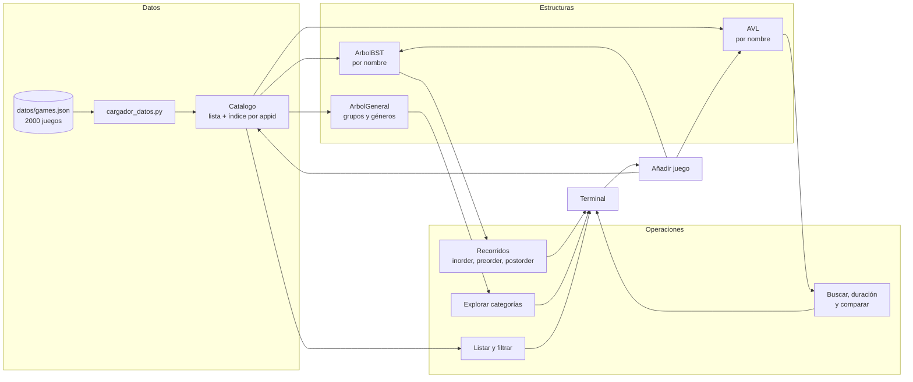

# Conexión entre estructuras

Este diagrama muestra cómo viajan los datos: desde el archivo hasta lo que ve el jugador, pasando por
cada estructura. Es el diagrama que usamos como guion en la defensa.

## Qué estructura resuelve cada problema

| Necesidad del jugador | Estructura | Por qué |
|---|---|---|
| Encontrar un juego por nombre | AVL | Se mantiene balanceado: la búsqueda es O(log n) aunque los datos entren ordenados |
| Ver los juegos en orden alfabético | BST (inorder) | El recorrido inorder entrega los datos ordenados |
| Navegar los géneros por grupos | Árbol general | Cada grupo tiene una cantidad distinta de hijos |
| Listar o filtrar | Lista del catálogo | Hay que recorrer todo igual, no hace falta un árbol |
| Detectar un juego repetido por `appid` | Diccionario del catálogo | Acceso directo en O(1) |

## Qué pasa al añadir un juego

El sistema valida primero y modifica después, para no dejar las estructuras en estados distintos:

1. Valida el nombre y los géneros.
2. Busca el nombre en el AVL: si ya existe, rechaza.
3. Inserta en el BST. Si el BST supera el límite de recursión de Python, rechaza sin haber tocado nada.
4. Inserta en el AVL.
5. Agrega al catálogo.

## Fuera de la aplicación

Los scripts de `algoritmos/` no forman parte del menú: preparan la muestra, prueban las estructuras y
miden tiempos. El dataset completo (`lux/`) solo lo usan ellos y no se sube a GitHub.
